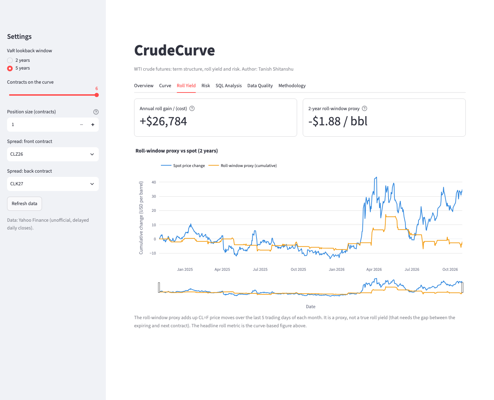
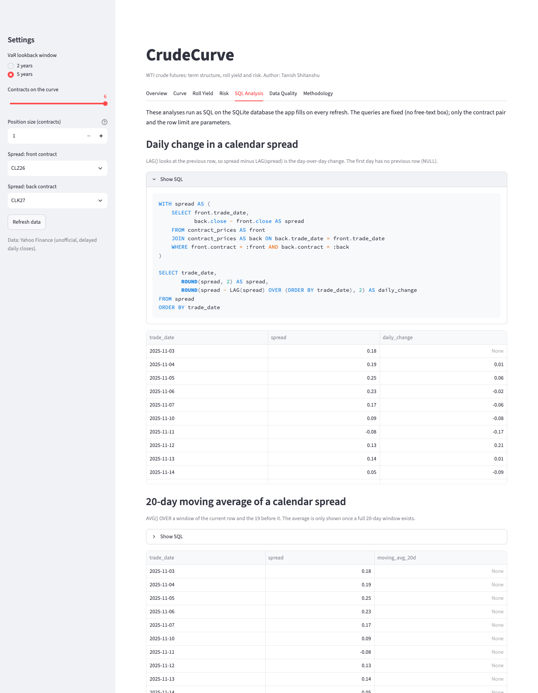
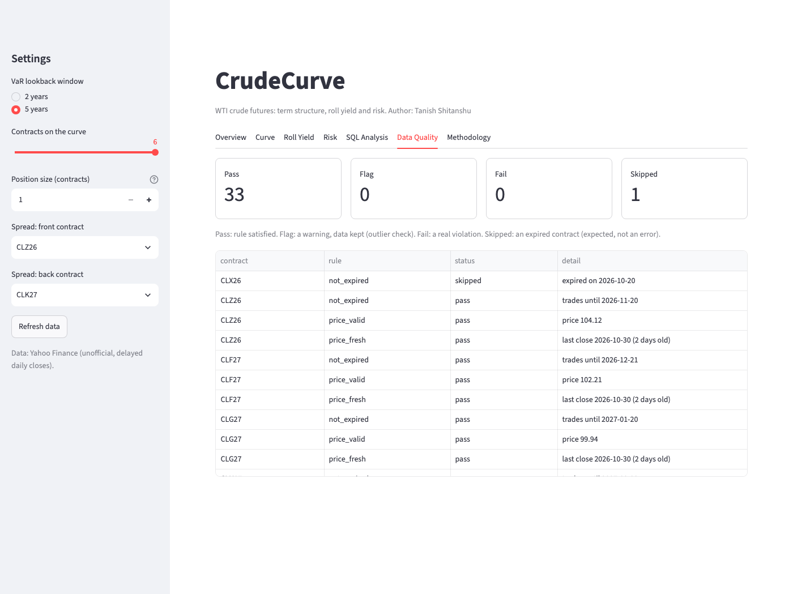
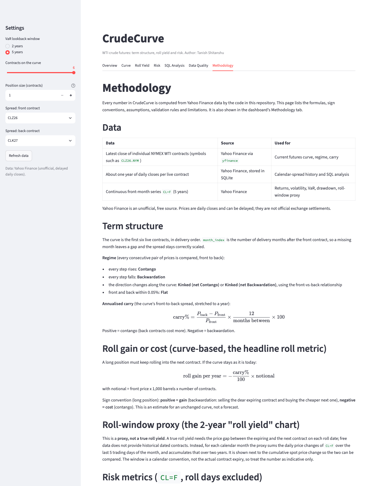
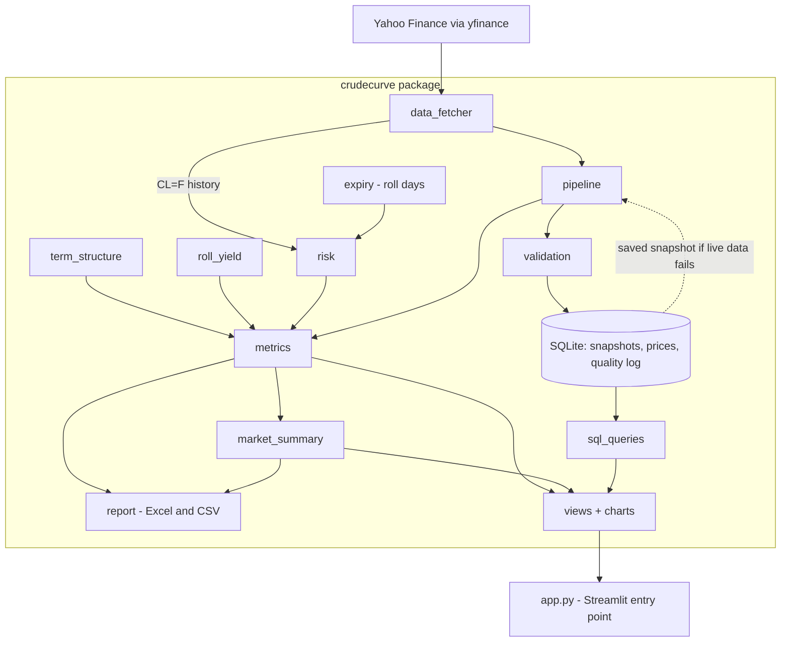

# CrudeCurve

**An interactive dashboard for WTI crude oil futures: classifies the curve as contango, backwardation or kinked, estimates what rolling a position costs, and measures one-day risk.**

[](https://github.com/Tanish-Shitanshu/crudecurve/actions/workflows/ci.yml)


Real prices from Yahoo Finance, checked against explicit business rules, stored in SQLite, and turned into an analysis-ready view of the market. No API key needed. Every number on screen is computed from real data.

## What it does

| Area | What you get |
|---|---|
| **Term structure** | The first six live WTI contracts, labelled contango, backwardation or kinked, with the annualised front-to-back carry |
| **Roll gain / cost** | Yearly gain or cost of rolling a long position if the curve stays unchanged, plus a 2-year roll-window *proxy* |
| **Risk** | Historical-simulation 1-day VaR (95% and 99%, with observation counts), 21-day volatility, max drawdown, worst day |
| **Data validation** | 7 business rules on every refresh (expiry, price validity, freshness, duplicates, ordering, minimum contracts, outliers), all logged |
| **SQL analysis** | 4 read-only queries on the stored data (`LAG()` spread changes, 20-day `AVG() OVER`, top spread moves, quality problems by rule), SQL text shown |
| **Reporting** | Excel report (5 sheets), curve CSV, and a rule-based written market summary |
| **Resilience** | If Yahoo is unreachable, shows the last saved snapshot with a clear banner, never old data as live |

## Screenshots

The Overview tab is above. The other six tabs (click an image for full size):

<table>
  <tr>
    <td align="center"><b>Curve</b><br><a href="docs/screenshots/curve.png"></a></td>
    <td align="center"><b>Roll Yield</b><br><a href="docs/screenshots/roll-yield.png"></a></td>
    <td align="center"><b>Risk</b><br><a href="docs/screenshots/risk.png"></a></td>
  </tr>
  <tr>
    <td align="center"><b>SQL Analysis</b><br><a href="docs/screenshots/sql-analysis.png"></a></td>
    <td align="center"><b>Data Quality</b><br><a href="docs/screenshots/data-quality.png"></a></td>
    <td align="center"><b>Methodology</b><br><a href="docs/screenshots/methodology.png"></a></td>
  </tr>
</table>

## Quick start

```bash
git clone https://github.com/Tanish-Shitanshu/crudecurve.git
cd crudecurve
pip install -r requirements.txt
streamlit run app.py
```

The first run downloads about a year of daily closes per live contract into `data/crudecurve.db` (git-ignored), so it takes a little longer.

**Deploying to Streamlit Community Cloud:** no secrets are needed. Create an app from this repository (branch `master`, main file `app.py`) and choose Python 3.13 under *Advanced settings*. The cloud disk is ephemeral, so the database is rebuilt after a restart.

## Tests

```bash
pip install -r requirements-dev.txt
pytest -q        # 152 tests, fully offline (network mocked, database in memory or a temp file)
ruff check .
```

The tests cover each validation rule, storage, the risk metrics against hand-checked synthetic series, every SQL query on a small fixture, the Excel workbook contents, the charts, and the whole Streamlit app (with Streamlit's `AppTest`) including the saved-snapshot fallback. GitHub Actions runs `ruff` and `pytest` on every push and pull request.

## Architecture



```
app.py                      # Streamlit entry point: sidebar, data loading, tabs
crudecurve/
  config.py                 # every constant and threshold in one place
  data_fetcher.py           # the only module that touches the network
  pipeline.py               # fetch -> validate -> save, with saved-snapshot fallback
  validation.py             # business rules: pass / fail / flag / skipped
  storage.py                # SQLite tables and idempotent upserts
  expiry.py                 # NYMEX expiry rule and roll days
  term_structure.py         # curve classification and annualised carry
  roll_yield.py             # 2-year roll-window proxy
  risk.py                   # returns, volatility, VaR, drawdown, roll gain
  metrics.py                # one dictionary of headline metrics for screen, Excel and text
  sql_queries.py            # fixed, parameterised, read-only SQL
  report.py                 # Excel workbook and CSV
  market_summary.py         # deterministic written summary (no model)
  formatting.py             # number and currency formatting
  charts.py                 # all Plotly figures
  views.py                  # one render function per tab
docs/METHODOLOGY.md         # every formula, sign convention and rule
tests/                      # offline tests
```

## Methodology in brief

- **Carry** = (back − front) / front × 12 / months between × 100. Positive = contango.
- **Roll gain per year** (long position) = −carry% × notional. Positive = gain, negative = cost.
- **VaR** (historical simulation) = the (1 − confidence) percentile of past daily returns applied to the position value. The observation count is always shown beside it, and the last 12 months are shown next to the selected window.
- **Roll days** (when `CL=F` switches contract) are found with the NYMEX expiry rule and excluded from returns, because that jump is a contract switch, not a market move.

All formulas, sign conventions and the validation rules are in [docs/METHODOLOGY.md](docs/METHODOLOGY.md); the dashboard's Methodology tab shows the same text.

## Limitations

- **Yahoo Finance data is unofficial and delayed.** Prices are daily closes, not exchange settlements, and symbols can change without notice.
- **The roll-window yield is a proxy**, not a true roll yield: it sums month-end price moves of the continuous series because free data has no history of expired contracts. The curve-based roll gain is the headline roll metric.
- **VaR is historical simulation on daily closes.** It assumes the past is representative of the future and cannot see moves within a day. The 99% figure rests on few observations, especially over 12 months.
- **Roll-day exclusion has a trade-off.** About 5% of days are dropped, and a few may hold real moves, so VaR may be slightly understated. Large moves that are not roll days are kept.
- **Volatility cluster in the data.** March to April 2026 shows very large front-month moves, in the same direction as deferred contracts but much larger, consistent with a front-month squeeze in strong backwardation. The cause was not verified. It is why the last-12-months VaR is shown next to the longer window.
- **Offline fallback covers the curve only.** The saved snapshot restores the curve, but the `CL=F` history is not stored, so risk figures are unavailable while Yahoo is down.
- Business-day calendars are approximate (US federal holidays, not the exchange calendar).
- **Not investment advice.**

## License

MIT, see [LICENSE](LICENSE).
