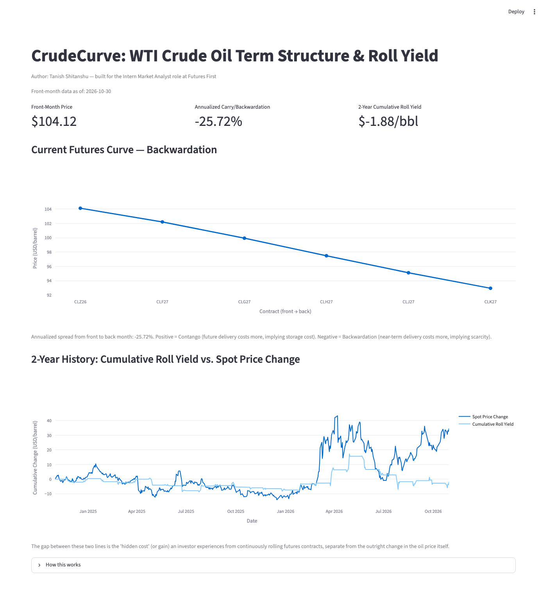

# CrudeCurve

**WTI Crude Oil Term Structure & Roll Yield Visualizer**


Visualizing what the oil futures curve reveals about storage costs and
market stress, and quantifying the cost of holding a rolling futures
position over time.

Author: **Tanish Shitanshu** — built as a portfolio project targeting the
**Intern Market Analyst** role at Futures First.

CrudeCurve visualizes the WTI crude oil futures curve (front-month vs.
forward-month prices) to classify the market as **contango** or
**backwardation**, and quantifies the **roll yield** an investor
experiences from continuously rolling a long futures position over time.

## Table of Contents

- [Quick Start](#quick-start)
- [Why This Matters](#why-this-matters-plain-english)
- [Formulas Used](#formulas-used)
- [Setup](#setup)
- [Data Source and Limitations](#data-source-and-limitations)
- [Screenshot](#screenshot)
- [Project Structure](#project-structure)

## Quick Start

```bash
git clone https://github.com/Tanish-Shitanshu/crudecurve.git
cd crudecurve
pip install -r requirements.txt
streamlit run app.py
```

No API key or configuration is needed. See [Setup](#setup) below for
running the test suite.

## Why this matters (plain English)

A futures contract is a promise to buy or sell oil at a set price on a
future date. Storing a physical barrel of oil costs money — tanks,
insurance, and the financing cost of cash tied up in inventory. Because
of that, a contract for delivery further in the future would "normally"
cost a bit more than one for delivery sooner, to compensate whoever is
holding the barrels in the meantime. A curve that rises with time to
delivery is called **contango**.

Sometimes the opposite happens: the market pays *more* for oil right
now than for oil delivered later. That's **backwardation**, and it
usually signals the market is worried about a near-term shortage —
buyers would rather have a barrel today than a cheaper promise of one
next month.

This matters to anyone trading or analyzing futures because you can't
hold a single futures contract forever — it expires. An investor who
wants ongoing oil exposure (e.g. via an ETF) must keep "rolling":
selling the contract about to expire and buying the next month's
contract. In contango, that means constantly selling low and buying
high — a steady drag on returns called **negative roll yield**, even if
the spot price of oil doesn't move at all. In backwardation, rolling
works in the investor's favor — **positive roll yield**. This is why
long-oil ETFs can lose money in a flat oil market, or make money before
the spot price even moves.

## Formulas used

**Annualized contango/backwardation spread** (`term_structure.py`):

```
spread_pct = (far_price - front_price) / front_price * (12 / months_between) * 100
```

- `front_price`: price of the nearest-expiry contract
- `far_price`: price of the furthest-out contract in the ladder
- `months_between`: number of contract months separating them
- Positive result → contango (annualized implied storage cost)
- Negative result → backwardation (annualized implied scarcity premium)

**Curve classification** (`term_structure.py`): contracts are sorted
front-to-back and every consecutive pair is compared. If every step
rises, the curve is Contango; if every step falls, it's Backwardation.
If the curve changes direction partway through, it's reported as
"Kinked" along with the net front-vs-back relationship, rather than
forcing a clean label onto a curve that isn't actually monotonic.

**Roll yield simulation** (`roll_yield.py`): for each calendar month in
the 2-year lookback, the last `ROLL_DAYS_BEFORE_MONTH_END` (5) trading
days are treated as the "roll window," where the front-month continuous
series absorbs the switch from the expiring contract to the next one.
Price moves during that window are summed into a running
**cumulative roll yield**; the total price move since the start of the
window is tracked separately as **cumulative spot change**, so the two
can be compared side by side.

## Setup

```bash
pip install -r requirements.txt
streamlit run app.py
pytest
```

All market data comes from Yahoo Finance via `yfinance`, which needs no
API key, account or `.env` file. The unit tests are offline: all network
calls are mocked, so no internet connection is needed to run them.

The suite covers curve classification and the annualized spread
(`test_term_structure.py`), the roll-yield simulation against
hand-computed price series (`test_roll_yield.py`), and the Yahoo Finance
contract handling — candidate ticker generation, live / expired / missing
contracts, `month_index` spacing, network errors and the history cleanup
(`test_data_fetcher.py`).

## Data source and limitations

**Forward curve (Yahoo Finance dated contracts):** the current curve is
built from individual NYMEX WTI contracts using Yahoo's per-contract
symbols, `CL<month code><YY>.NYM` — for example `CLZ26.NYM` is the
December 2026 contract. On each run the app generates candidates for the
next 9 delivery months starting from the current month, fetches each
contract's latest daily close, and keeps the **first 6 live contracts**
as the curve. Contracts that return no data (already expired) or whose
latest close is more than 5 days old are dropped. `month_index` is the
number of delivery months after the front contract, so a skipped month
leaves a gap and the annualized spread stays correctly scaled.

**Front-month history (yfinance):** `CL=F`, the continuous front-month
WTI contract, supplies the 2-year daily history used in the roll-yield
backtest.

**Caveats:** Yahoo Finance is a free, unofficial data source. Prices are
daily closes rather than official exchange settlements, can be delayed,
and symbol availability can change without notice. The curve is a
snapshot of the latest available close, not a live tick feed.

The app never fabricates a price for a missing contract: if Yahoo has no
data for a contract, it is dropped from the curve rather than estimated.
If no contract is live at all, the dashboard shows an error instead of a
chart.

The roll-yield simulation works around the lack of a full historical
forward ladder by using the front-month continuous series' own
month-end price behavior as a proxy for the realized roll effect (see
the docstring in `roll_yield.py` for the full explanation).

## Screenshot



The dashboard shows the current WTI futures curve with its market label
(here, backwardation), the annualized carry, and the 2-year cumulative roll
yield against the spot price change.

## Project structure

```
crudecurve/
├── README.md
├── requirements.txt
├── config.py              # tickers, contract symbol template, lookback window, notes
├── data_fetcher.py        # Yahoo Finance contracts (curve) + CL=F (history) data pulls
├── term_structure.py      # curve classification + annualized spread
├── roll_yield.py          # 2-year roll yield backtest
├── app.py                 # Streamlit dashboard
├── docs/
│   └── screenshot.png     # dashboard screenshot used in this README
└── tests/
    ├── test_term_structure.py   # curve classification + annualized spread
    ├── test_roll_yield.py       # roll-yield simulation on synthetic series
    └── test_data_fetcher.py     # contract fetching / history cleanup (network mocked)
```
