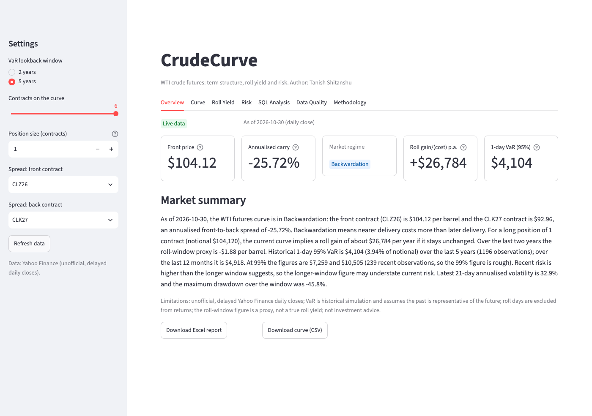
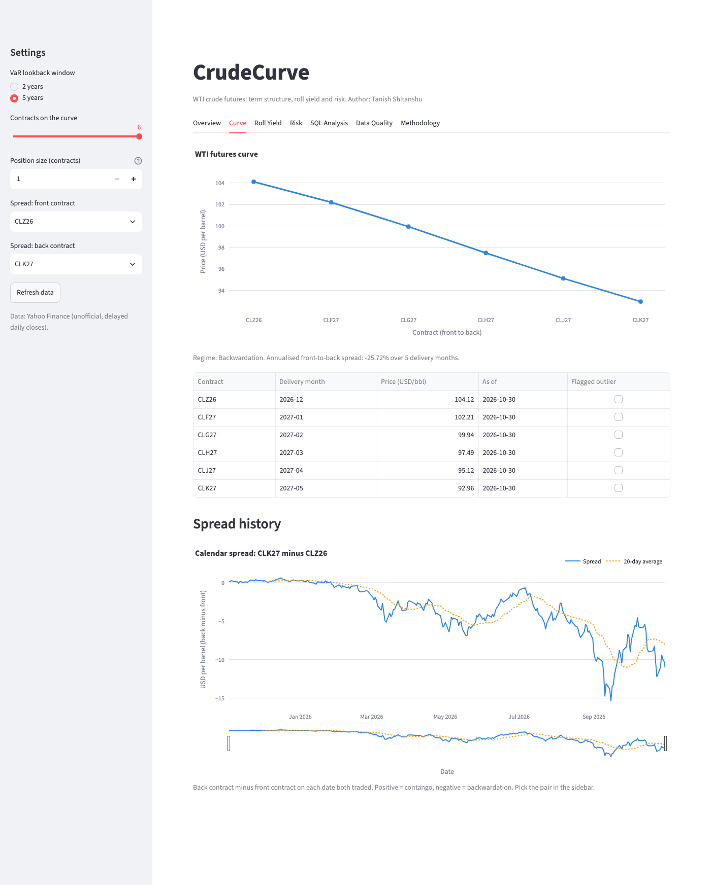
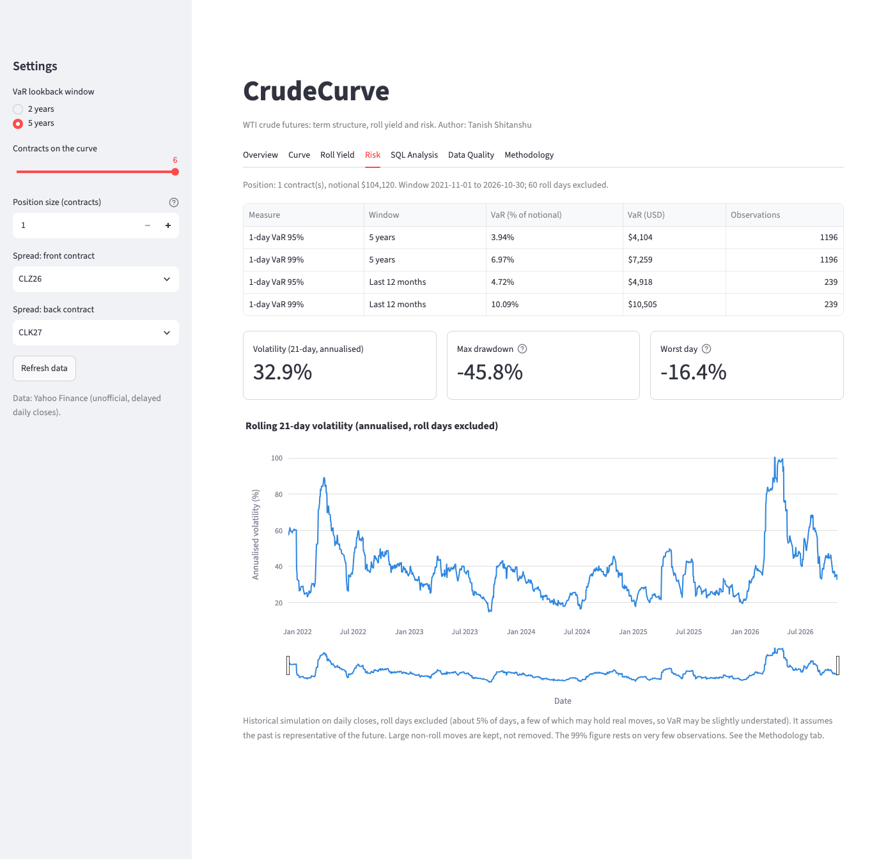
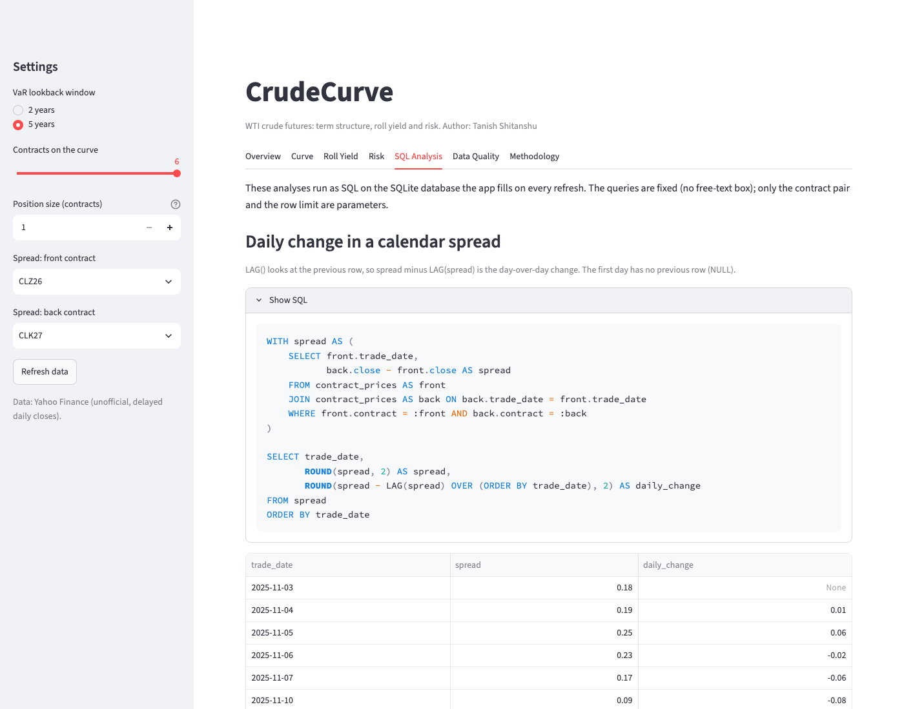
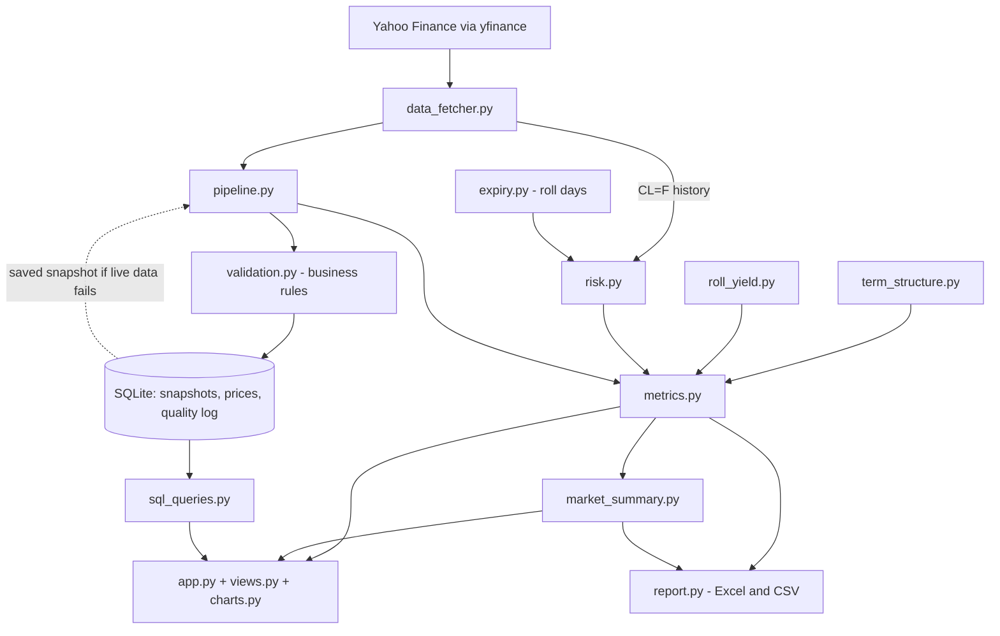

# CrudeCurve

**WTI crude oil futures: term structure, roll yield and risk, in one dashboard.**

[](https://github.com/Tanish-Shitanshu/crudecurve/actions/workflows/ci.yml)


Author: **Tanish Shitanshu**

CrudeCurve pulls real WTI futures prices from Yahoo Finance, checks them against explicit
business rules, stores them in a local SQLite database, and turns them into an
analysis-ready picture of the market: is the curve in **contango** or **backwardation**, what
does rolling a long position cost or earn, and how much could a position lose in a day
(**Value at Risk**). Every number on screen is computed from real data.



## What it does

| Area | What you get |
|---|---|
| **Term structure** | The curve of the first six live WTI contracts, classified as contango, backwardation or kinked, with the annualised front-to-back carry |
| **Roll gain / cost** | The yearly gain or cost of rolling a long position if the curve stays unchanged (positive = gain), plus a 2-year roll-window *proxy* from month-end price moves |
| **Risk** | Historical-simulation 1-day VaR at 95% and 99% (selected lookback next to the last 12 months, with observation counts), 21-day volatility, max drawdown, worst day |
| **Data validation** | Seven business rules (expiry, price validity, freshness, duplicates, ordering, minimum contracts, outliers); every outcome is logged |
| **SQL analysis** | Preset read-only SQL: `LAG()` spread changes, a 20-day `AVG() OVER` moving average, top spread moves, data-quality problems by rule, with the SQL text shown |
| **Reporting** | Excel report (Summary, Curve, History, Risk, Data Quality sheets), a CSV of the curve, and a rule-based written market summary |
| **Resilience** | If Yahoo is unreachable the app shows the last saved snapshot with a clear banner, and never presents old data as live |

<details>
<summary>More screenshots (Curve, Risk, SQL Analysis)</summary>







</details>

## Quick start

```bash
git clone https://github.com/Tanish-Shitanshu/crudecurve.git
cd crudecurve
pip install -r requirements.txt
streamlit run app.py
```

No API key, account or `.env` file is needed. The first run downloads about a year of daily
closes for each live contract into `data/crudecurve.db`, so it takes a little longer.

## Tests and linting

```bash
pip install -r requirements-dev.txt
pytest -q        # fully offline: all network calls are mocked, the database is in memory or a temp file
ruff check .
```

The tests cover each validation rule, storage (in-memory SQLite), the risk metrics against
hand-checked synthetic series, every SQL query on a small fixture, the Excel workbook contents,
and the whole Streamlit app (with Streamlit's `AppTest`), including the saved-snapshot fallback.
GitHub Actions runs `ruff` and `pytest` on every push and pull request.

## Architecture and data flow



**Project structure**

```
crudecurve/
├── app.py               # Streamlit page: sidebar, data loading, tabs
├── views.py             # one render function per tab
├── charts.py            # all Plotly figures, one shared look
├── config.py            # every constant and threshold in one place
├── data_fetcher.py      # the only module that touches the network (yfinance)
├── pipeline.py          # fetch -> validate -> save, with saved-snapshot fallback
├── validation.py        # business rules, each returns pass / fail / flag / skipped
├── storage.py           # SQLite tables and idempotent upserts
├── expiry.py            # NYMEX expiry rule and roll days
├── term_structure.py    # curve classification and annualised carry
├── roll_yield.py        # 2-year roll-window proxy
├── risk.py              # returns, volatility, VaR, drawdown, roll gain
├── metrics.py           # one dictionary of headline metrics for screen, Excel and text
├── sql_queries.py       # fixed, parameterised, read-only SQL
├── report.py            # Excel workbook and CSV
├── market_summary.py    # deterministic written summary (no model)
├── formatting.py        # number and currency formatting
├── docs/METHODOLOGY.md  # every formula, sign convention and rule
├── tests/               # offline tests
└── .github/workflows/ci.yml
```

## Methodology in brief

- **Carry** = (back − front) / front × 12 / months between × 100. Positive = contango.
- **Roll gain per year** (long position) = −carry% × notional. Positive = gain, negative = cost.
- **VaR** (historical simulation) = the (1 − confidence) percentile of past daily returns,
  applied to the position value. The number of observations is always shown beside it.
- **Roll days** (the day `CL=F` switches contract) are found with the NYMEX expiry rule and
  excluded from returns, because the jump is a contract switch, not a market move.

Full formulas, sign conventions and the validation rules are in
[docs/METHODOLOGY.md](docs/METHODOLOGY.md), which the dashboard also shows in its
Methodology tab.

## Limitations

- **Yahoo Finance data is unofficial and delayed.** Prices are daily closes, not exchange
  settlements, and symbols can change without notice.
- **The roll-window yield is a proxy**, not a true roll yield. It sums month-end price moves of
  the continuous series because free data has no history of expired contracts. The
  curve-based roll gain is the headline roll metric.
- **VaR is historical simulation on daily closes.** It assumes the past is representative of
  the future and cannot see moves within a day. The 99% figure rests on few observations,
  especially over 12 months.
- **Roll-day exclusion has a trade-off.** About 5% of days are dropped; a few of them may hold
  real moves, so VaR may be slightly understated. Large moves that are not roll days are kept.
- **Volatility cluster in the data.** March to April 2026 shows a cluster of very large daily
  moves in the front month, in the same direction as deferred contracts but much larger,
  consistent with a front-month squeeze in strong backwardation. The cause was not verified.
  It is why the last-12-months VaR is shown next to the longer window.
- Business-day calendars are approximate (US federal holidays, not the exchange calendar).
- **Not investment advice.**

## Deploying to Streamlit Community Cloud

No secrets are needed. In [share.streamlit.io](https://share.streamlit.io): create an app from
this GitHub repository, branch `master`, main file `app.py`, and choose Python 3.13 under
*Advanced settings*. The cloud disk is ephemeral, so the SQLite file is rebuilt after a restart
(the first load downloads the contract history again, and the saved-snapshot fallback only
helps while the app stays running).

## License

MIT, see [LICENSE](LICENSE).
